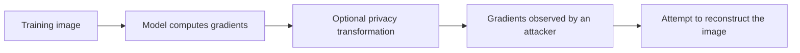

# Gradient Inversion Playground

**Can an AI model reveal a private image from the information it shares while learning?**

Gradient Inversion Playground is a Python research toolkit for investigating that question. It recreates *gradient inversion attacks*—attempts to recover training data from model updates—and compares methods intended to reduce what those updates reveal.

This project combines machine-learning security research with an experiment runner, configurable attacks and defenses, saved results, and a visual results viewer.

> **The short version:** AI models learn by calculating updates called **gradients**. Those updates can contain clues about the data used to produce them. This project tests how much an attacker might recover from those clues, and what happens when the updates are changed before being observed.

## Why this matters

Imagine several organizations collaborating to train an AI model without directly sharing their private images. They may exchange model updates instead of the images themselves. That is useful—but **not automatically private**: some updates can be used to approximate the original training data.

Gradient inversion is one way to study this risk. The practical question is not just *“Can an attack run?”* but *“What information can it actually recover, under which assumptions, and how does a proposed defense change the result?”*

## How the project works



1. **Choose a setting.** Pick a dataset, neural-network model, reconstruction attack, and optional defense.
2. **Simulate what an attacker sees.** Compute gradients from an example image and, if selected, alter those gradients.
3. **Try to recover the image.** Optimize a candidate image so its gradients resemble the observed ones.
4. **Measure the result.** Compare the reconstructed image with the original using image-quality metrics; keep configuration, diagnostic, and error records.

The experiment runner separates the *attacker's available information* from *ground-truth information used to evaluate the attack*. This distinction matters when assessing whether an attack really succeeded.

## What I've built

| Part | What it does | Why it is useful |
| --- | --- | --- |
| **Reconstruction experiments** | Runs gradient inversion methods, including DLG and iDLG presets | Tests whether model updates expose example data |
| **Defense experiments** | Changes gradients using noise, clipping, pruning, quantization, and research-oriented transformations | Measures how different changes affect reconstruction |
| **Experiment framework** | Uses Python components and YAML configuration to combine models, datasets, attacks, and defenses | Makes comparisons reproducible and extensible |
| **Results and visualization** | Saves run metadata, image reconstructions, error reports, and metrics; provides a Streamlit viewer | Makes experiments inspectable rather than relying on a single screenshot |
| **Multi-server gradient-disguise experiment** | Splits a gradient into shares and studies what different subsets of those shares reveal | Explores a possible direction for reducing leakage when not every server is trusted |

### Two related research tracks

**1. Attack and defense benchmarking.** Run an attack against ordinary gradients, then compare it with the same attack applied to transformed gradients. The framework supports different models, attacks, metrics, and experimental settings. See the [technical guide](docs/TECHNICAL_GUIDE.md) for the protocol and implementation notes.

**2. Gradient disguise across multiple servers.** In a separate experimental workflow, multiple gradient shares are constructed to combine into the original update. The experiment tests whether a *subset* of those shares is closer to a chosen public example's gradient than to the private example's gradient—and then tests what reconstruction attacks actually produce. Gradient-space closeness **does not itself establish** that an attack will reconstruct the public example. See the [gradient-disguise experiment](experiments/coalition_disguise/README.md) and its [baseline failure review](experiments/coalition_disguise/REVIEW.md).

## What a result means

The viewer reports comparisons such as:

- **MSE (mean squared error):** the average squared difference between the reconstructed and original pixels. *Lower* generally means a closer pixel match.
- **SSIM (structural similarity):** a measure of visual similarity. *Higher* generally means the images have more similar structure.
- **Attack outcome and diagnostics:** whether an attack met the configured evaluation target, exhausted its budget, stalled, or encountered a numerical/setup error.

**An attack failing to reconstruct an image is not proof that a defense guarantees privacy.** The result depends on the model, dataset, attacker knowledge, optimization settings, and computational budget. The code also contains numerical and theoretical investigations; some proposed lower bounds remain conditional rather than certified guarantees.

## Try it yourself

The following commands are for a **CPU-based Python 3.12 environment**. They have not been independently clean-install tested as part of this documentation change. Execute them from the repository root.

```bash
git clone https://github.com/Godlytomato/gradient_inversion_playground.git
cd gradient_inversion_playground
python3 -m venv .venv
source .venv/bin/activate

# Install the CPU builds of PyTorch and torchvision
python -m pip install --index-url https://download.pytorch.org/whl/cpu torch==2.8.0 torchvision==0.23.0
python -m pip install -r requirements-cpu.txt
python -m unittest discover -s tests -v
```

The tests use synthetic inputs and temporary databases; they do **not** require downloading CIFAR-10 or using a GPU.

### Run one example instead of the full experiment matrix

Create one experiment configuration, then run only that configuration:

```bash
python - <<'PY'
from pathlib import Path
from validation.generator import generate_run, save_yaml
from validation.registries.registry_builder import build_registries

presets = build_registries()
example = generate_run(
    presets["attacks"]["dlg"],
    presets["defenses"]["none"],
    presets["models"]["lenet5"],
    presets["datasets"]["cifar10"],
    target=0.02,
)
save_yaml(example, Path("demo_schedule"))
PY

python run.py --schedule demo_schedule --strict-errors
python -m streamlit run interface.py --browser.gatherUsageStats false
```

The first real CIFAR-10 run downloads the dataset into `data/`, needs internet access, and can be computationally expensive on CPU. The repository's existing `schedual/` directory contains many other configurations; **do not run that entire directory expecting a quick demo**. The unusual spelling `schedual` is the directory name used by the current code.

The runner initializes or migrates its SQLite database without deleting past experiments. **Do not use** `python -m database.setup --reset` unless you intentionally want to delete the existing database and results.

## Repository tour

| Location | Start here if you want to… |
| --- | --- |
| [`run.py`](run.py) | See how scheduled experiments are executed and errors are recorded |
| [`validation/`](validation/) | See experiment presets, generation, and configuration checks |
| [`reconstruction/`](reconstruction/) | Explore reconstruction attacks and optimization |
| [`transformations/`](transformations/) | Explore gradient defenses and transformations |
| [`observer/`](observer/) | See how attack behavior and reconstruction quality are measured |
| [`database/`](database/) and [`interface.py`](interface.py) | Explore saved results and the Streamlit viewer |
| [`experiments/coalition_disguise/`](experiments/coalition_disguise/) | Explore the multi-server gradient-disguise investigation |
| [`tests/`](tests/) | Review automated checks |
| [`docs/`](docs/) | Read numerical analyses, assumptions, limits, and deeper protocol details |

### A few terms in plain English

**Gradient:** numbers describing how a model should change its parameters as it learns from an example.

**Gradient inversion:** an attempt to work backward from those numbers to reconstruct the data that generated them.

**Defense / transformation:** a modification to the shared gradients intended to reduce information leakage.

**Gradient share:** one part of an update distributed across multiple participants; combining all shares recovers the intended update.

**Reproducible experiment:** a run with recorded configuration and random seeds so that comparisons can be repeated and audited.

## Research status and limitations

This is an **experimental research codebase**, not a deployed privacy service or a demonstrated security guarantee. The standard generated protocol currently evaluates randomly initialized models in evaluation mode; that is **not** the same as benchmarking production-trained models. The multi-server disguise study works with constructed shares and attack simulations, not a live network deployment.

For scientific assumptions, numerical convergence limits, and the difference between empirical evidence and certified claims, see the [technical guide](docs/TECHNICAL_GUIDE.md), [scientific-readiness analysis](docs/SCIENTIFIC_READINESS.md), and [residual-bound discussion](docs/RESIDUAL_BOUND.md).
